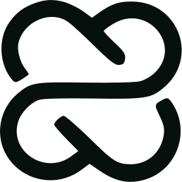

<picture>
  <source media="(prefers-color-scheme: dark)" srcset="mark-dark.svg">
  
</picture>

### Crafter Research

Autonomous research you can check.

[crafter.ing](https://crafter.ing) · [frontier](https://crafter.ing/frontier) · [research log](https://crafter.ing/research)

We point agent fleets at open problems in math, computing, security, and the natural and social sciences. A problem gets in only if it has an oracle. Every claim ships with its preregistration, trace, artifact, and a person who signs it.

**Instruments**: [sismo-abierto](https://github.com/crafter-research/sismo-abierto) · [legalize-pe](https://github.com/crafter-research/legalize-pe) · [latambench](https://github.com/crafter-research/latambench) · [muniscan](https://github.com/crafter-research/muniscan) · [sunat-cli](https://github.com/crafter-research/sunat-cli)

Lima, Peru · part of the [Crafter universe](https://crafter.run/en/universe)
